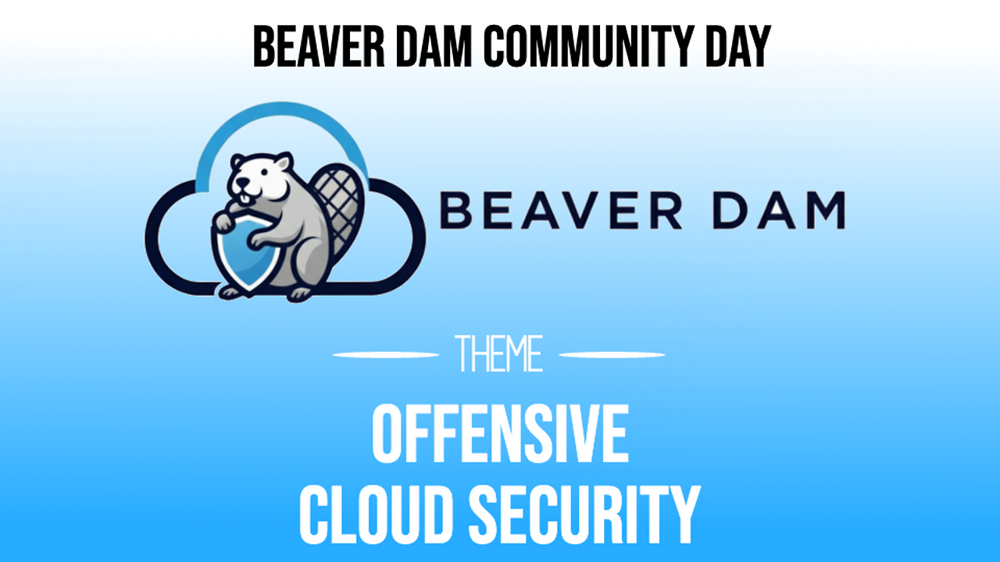

본 포스팅은 BlackHat2025 <em>"ECS-cape – Hijacking IAM Privileges in Amazon ECS"</em> 주제로 발표된 내용에 대한 포스팅입니다. 발표 영상은 [링크](https://youtu.be/WXdB-9pTqAU?si=Veot3xjjjCXoVp46)를 통해서도 확인하실 수 있습니다.

---

AWS ECS는 수많은 Production 환경의 Workload를 띄우는 오케스트레이터로서 활용됩니다. Task, Service, Task Definition을 통해 배포를 자동화하고, IAM Role 및 MetaData를 이용해 애플리케이션이 안전하게 AWS 리소스에 접근된다고 믿습니다.

하지만 <strong>누군가 AWS 리소스에서 정상 접근인냥 위장하여 인증을 수행하고, 컨테이너의 메타데이터를 조회할 수 있다면</strong> 어떨까요?

본 포스팅에서는 ECS Agent의 동작 원리를 분석하고, ACS, TMDS/IMDS 등 자격 증명 전달 및 주입 체인을 악용하여 다른 Task의 권한을 사칭(Impersonate)할 수 있는 공격 시나리오에 대해서 설명합니다.

결과적으로 컨테이너 경계가 무너지고, Secret에 대한 조회 및 S3 내 민감 리소스 접근이 가능하게 되며, 계정 내 권한 상승 공격까지 어떻게 이루어질 수 있는지 설명합니다.

---

## 1. ECS란?

ECS는 크게 Cluster, Service, Task, Task Definition으로 나뉩니다. 각각은 다음과 같습니다.

- <strong>Cluster</strong> : Task, Service와 같은 ECS 리소스가 실행되는 논리적 공간
- <strong>Service</strong> : 특정 Task Definition을 기반으로 정해진 개수의 Task가 항상 실행될 수 있도록 관리하는 컨트롤러
- <strong>Task</strong> : 실제 실행되는 컨테이너의 집합으로, 하나의 Task는 하나 이상의 컨테이너를 포함
- <strong>Task Definition</strong> : Task를 어떻게 실행할지 정의한 설계도로 어떤 이미지를 사용할지, CPU/Memory는 얼마로 할지 등을 정의

비유하자면, <strong>Cluster</strong>는 <strong>회사 건물</strong>로, <strong>Service</strong>는 <strong>팀장(매니저)</strong>, <strong>Task</strong>는 <strong>직원</strong>, <strong>Task Definition</strong>은 <strong>JD(Job Description)</strong>으로 비유할 수 있습니다.

Cluster는 회사 건물 처럼 책상, 인터넷, 전기를 제공하지만 실제 일을 하는 주체는 아닙니다. Service는 팀장(매니저)처럼 업무를 배분하기도 하고, 근무가 중단된 직원을 교체하기도 하며 전반적인 매니징 업무를 수행합니다. Task는 실제로 일을 하는 고용자, Task Definition은 어떤 일을 하는지에 대한 명세서로서 기능합니다.

여기까지가 ECS 안에서 리소스가 어떻게 구성되는지에 대한 이야기라면, 이제 <strong>이 리소스를 어디에 띄울 것인지</strong> 정하는 개념이 필요합니다. ECS에서는 이것을 <strong>Launch Type</strong>으로 부릅니다.

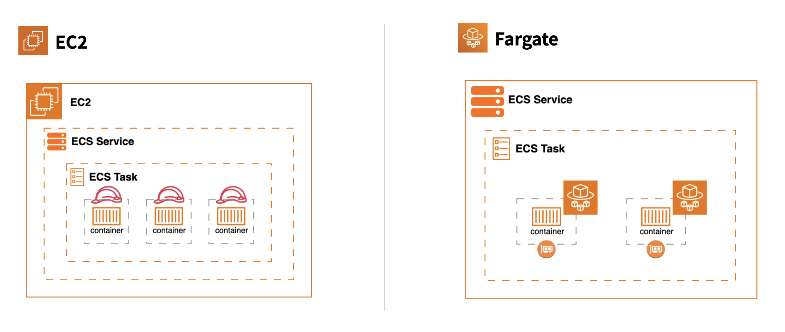

(좌) EC2 Launch Type (우) Fargate Launch Type

Launch Type은 크게 EC2와 Fargate 두 가지 방식으로 나뉩니다.

- <strong>EC2 Launch Type</strong> : 직접 ECS 클러스터에 붙는 EC2 인스턴스를 운영하면서 그 위에 Task를 올리는 방식
- <strong>Fargate</strong> : 인프라 관리는 AWS가 맡고 우리는 Task Definition과 실행만 신경쓰는 서버리스 방식

같은 Service, Task, Task Definition이더라도, 어떤 Launch Type을 선택하냐에 따라 비용 구조, 운영 책임, 보안 경계가 달라집니다.

위의 비유를 확장해보면, <strong>Launch Type은 "직원들을 어디에 앉혀서 일하게 할지"</strong>에 가깝습니다. <strong>EC2 Launch Type</strong>에서는 회사가 직접 사무실을 임대하고, 책상, 전기, 네트워크 환경을 직접 셋업한 후 직원을 배치하는 모습과 비슷합니다. 자유도가 높아 커스터마이징에 용이하다는 장점이 있지만, 유지보수에 대한 책임도 회사가 집니다.

반면 <strong>Fargate</strong>는 공유 오피스를 쓰는 것에 가깝습니다. 공간 운영과 인프라에 대한 관리는 센터에서 하고, 우리는 단순히 특정 일을 하는 사람들만 지정하고 관리하면 됩니다. 인프라 패치나 용량 관리를 신경 쓰지 않아도 되는 대신에, 정해진 규격 내에서만 움직여야합니다.

EC2 기반의 ECS 환경을 이해하려면 Task를 실제로 실행하고 관리하는 주체가 누구인지, 그리고 그 흐름을 제어하는 구조가 어떻게 되는지를 이해해야합니다. 이 역할을 실제로 수행하는 것은 EC2 인스턴스 내부에서 돌아가는 <strong>ECS Container Agent</strong>입니다.

이 Agent는 단순히 데몬이 아니라, ECS Control Plane과 Local Container Runtime사이에서 <strong>Task의 생명주기를 관리</strong>하고, <strong>자격증명을 중개</strong>하며, <strong>인스턴스 상태를 지속적으로 확인</strong>하는 관리자 역할을 수행합니다.

Control Plane으로 부터 "이 Task Definition으로 컨테이너를 띄워라" 라는 명령을 받으면, Agent는 해당 명령을 Local Container Runtime에 전달하여 컨테이너를 생성하고, Health Check, Logging 등을 설정할 수 있습니다.

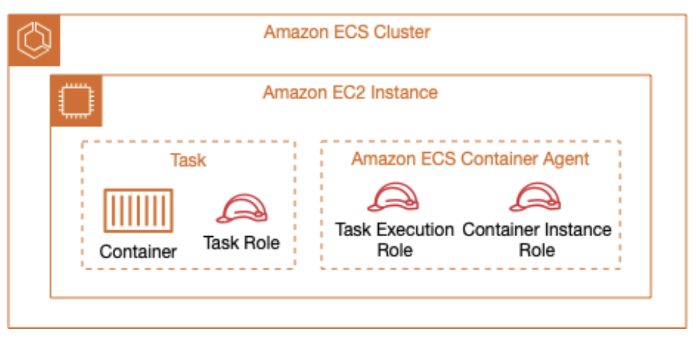

이 과정에서 <strong>권한과 자격증명의 흐름</strong>이 바로 이번 주제의 핵심입니다.

EC2 Launch Type에서는 위처럼 크게 세 가지 권한 주체가 존재합니다. EC2 Launch Type에서 Task 내 컨테이너들은 각각의 IAM Role을 가지는 형태로, 특정한 각각의 권한을 가지고 권한 내에서 리소스에 접근하게 되는 것입니다.

1. <strong>Task Role</strong> 인스턴스 자체에 붙는 Task Role은 컨테이너 안의 Application이 AWS 서비스를 접근할 때 사용합니다. 예를 들어, Task Definition에서 S3ReadOnlyRole을 명시하면, 컨테이너 내에서 aws s3 cp 명령어를 사용할 수 있게 됩니다.
2. <strong>Task Execution Role & Container Instance Role</strong> Agent가 가지는 대표적인 Role로, Agent는 <strong>Task Execution Role</strong>을 통해 컨테이너를 실행할 때 필요한 자격증명을 받아와 Agent가 Task를 실행할 수 있는 권한을 가지게 됩니다.

   <strong>Container Instance Role</strong>은 ECR로부터 컨테이너 이미지를 가져오거나 CloudWatch Logs에 로그를 쓸 수 있도록 하고, ECS에서 Telemetry Session을 시작하고 Container의 상태를 Update할 권한을 가집니다.

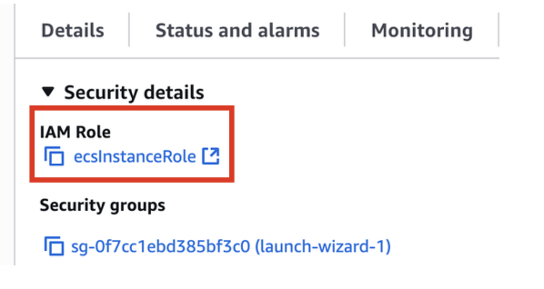

EC2 Launch Type으로 생성된 ECS의 인스턴스 &gt; 보안 탭에서 확인할 수 있는 <strong>ecsInstanceRole이 바로 Container Instance Role</strong>입니다.

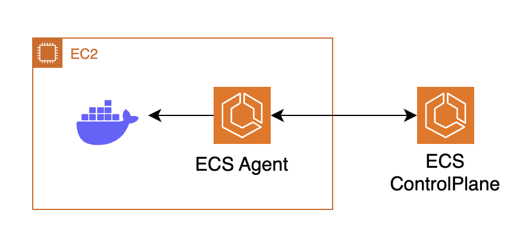

ECS Agnet의 역할

정리하자면, ECS의 EC2 Launch Type은 다음과 같은 구조를 통해 동작합니다.

1. EC2내 Agent가 가지는 Container Instance Role을 통해 Agent는 ECS Control Plane과 EC2 인스턴스에 설치된 컨테이너 사이 중개자 역할을 수행
2. ECS Control Plane에서 "이 Task Definition을 실행하라" 라는 명령을 내리면, EC2 인스턴스 내에 ECS Agent가 이 명령을 받아 Docker Runtime에 전달하고, Docker는 명령에 따라 컨테이너를 실행
3. 컨테이너 상태와 로그는 다시 Agent를 통해 ECS Control Plane으로 보고

---

## 2. ECS Task에 대한 모니터링은 어떻게 할 수 있을까?

ECS에서 실행 중인 Task를 모니터링하려면, 단순히 AWS 콘솔에서 서비스 상태를 확인하는 것으로는 부족합니다.

EC2 Launch Type 환경에서는 실제 컨테이너가 EC2 인스턴스 내부에서 어떻게 실행되고 있는지, 어떤 Task Definition을 기반으로 실행 중인지를 직접 확인해야합니다.

이를 위해 <em>docker ps</em> 명령을 통해 컨테이너 내에서 실행 중인 컨테이너를 확인하고, <em>inspect</em> 명령을 통해 실행 결과를 확인해보겠습니다.

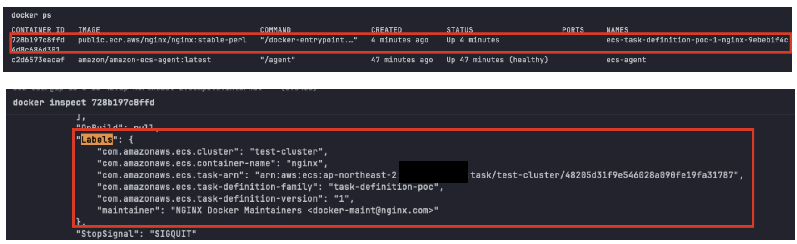

(위) docker ps 결과 (아래) docker inspect 결과

1. <strong><em>docker ps</em></strong> 먼저 EC2 인스턴스에 접속한 뒤, docker ps 명령을 입력하면 현재 실행 중인 컨테이너 목록을 확인할 수 있습니다. 사진에서 볼 수 있 듯, nginx 컨테이너와 amazon-ecs-agent 컨테이너가 실행 중인걸 확인할 수 있는데, 각각은 ECS에서 생성한 Task와 Agent 입니다.
2. <strong><em>docker inspect</em></strong> <em>docker inspect</em>명령을 통해, 컨테이너 내부 정보를 자세히 확인해보면 Cluster, Task, Task Definition에 대한 정보는 나타나 있지만,Service에 대한 정보는 확인할 수 없습니다.

Service에 대한 정보를 확인하려면, <strong>Amazon ECS task metadata endpoint</strong>를 활용할 수 있습니다. 이 Endpoint를 통해 Cluster, TaskARN, Revision, Launch Type 등 ECS Container <strong>Agent가 각 컨테이너에 주입하는 환경변수</strong>를 확인할 수 있습니다.

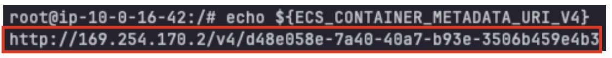

아래 사진처럼, 해당 메타데이터 앤드포인트에서는 우리가 docker inspect 명령으로 확인할 수 없던 Service의 정보도 확인할 수 있습니다. 실제 콘솔에서 확인할 수 있는 Service 정보를 반환하는 것을 볼 수 있습니다.

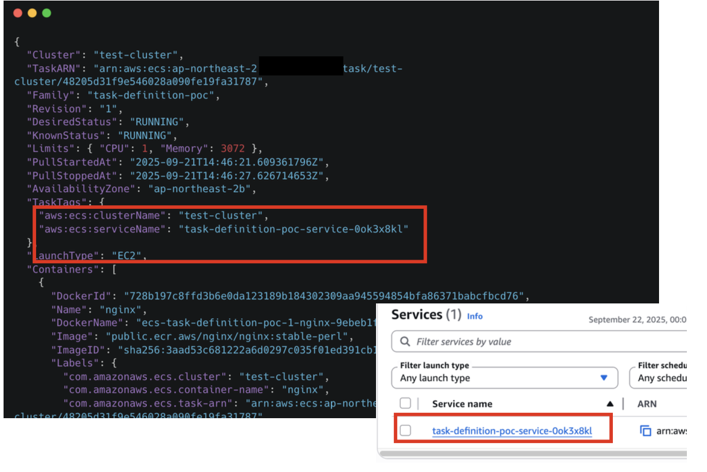

그렇다면 일반적인 docker 명령을 통해 확인할 수 없던 Service에 대한 정보를 Agent는 알고 있는 것인데, <strong>Agent는 어떻게 Service에 대한 정보를 가지고, 컨테이너에 환경변수로서 주입할 수 있는걸까요?</strong>

---

## 3. ECS Agent는 어떻게 Service를 List 할까?

### 1) Container Instance Role

위 질문에 대답하기 위해서, 첫번째로 앞서 살펴봤던 <strong>Container Instance Role의 세부 권한을 확인</strong>해보겠습니다.

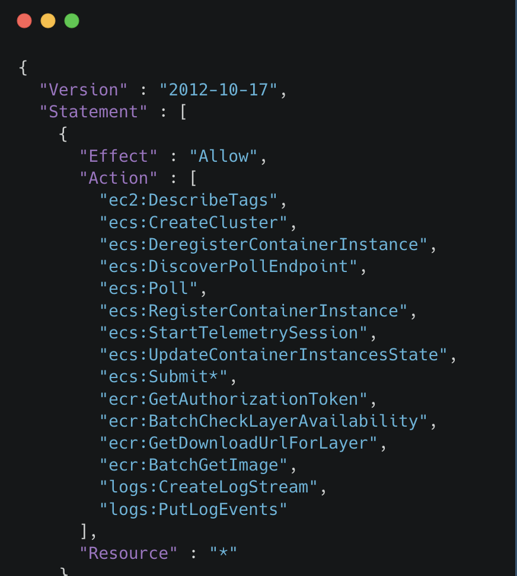

AmazonEC2ContainerServiceforEC2Role

ecs와 관련한 권한들을 살펴보면, Cluster 생성, Container Instance에 대한 등록과 회수 등등 다양한 권한이 있지만, 놀랍게도 <strong>Service를 List하는 것과 관련한 권한은 없습니다.</strong> 그렇다면 AWS에서 Service를 List하는 API가 없는걸까요?

실제 공식 문서를 살펴보면, ECS의 ListService API는 존재합니다. ([AWS 공식문서 - ecs:ListServices](https://docs.aws.amazon.com/ko_kr/AmazonECS/latest/APIReference/API_ListServices.html))

### 2) ECS Agent Code

Container Instance Role은 아니니, 두번째로는 <strong>오픈소스로 공개된 ECS agent의 코드</strong>를 통해 ECS Agent의 동작 원리를 살펴보며 어떻게 Service를 List할 수 있는지 확인해보겠습니다. ([Github 링크](https://github.com/aws/amazon-ecs-agent/blob/master/README.md))

Agent가 실행되면, 먼저 Credential Manager을 생성하여 임시 자격증명을 관리할 준비를 합니다.

그 다음 Agent는 TMDS(Task Metadata Service)를 로컬에 띄워 나중에 컨테이너가 자격증명을 요청할 수 있도록 합니다.

이후, Agent는 ECS Control Plane과 통신하기 위해 ACS(Amazon ECS Communication Service) Endpoint를 탐색하고, 해당 Endpoint와 WebSocket 세션을 맺습니다.

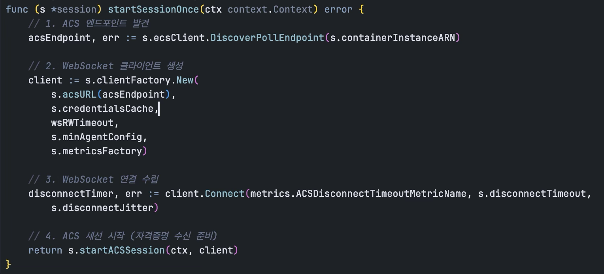

Agent가 WebSocket Session을 맺는 로직

이 WebSocket은 Agent가 Control Plane으로부터 명령을 실시간으로 수신하고, 현재 인스턴스의 상태나 실행 중인 Task 목록을 주고받는 통로가 됩니다. <strong>연결이 수립되면, Control Plane은 Task 실행에 필요한 임시 자격증명을 Agent에 전달</strong>하고, Agent는 이 자격증명을 Credential Manager에 저장하여 실제 컨테이너가 시작될때 이 정보를 주입해 Task 내부 애플리케이션이 AWS 리소스에 접근할 수 있게됩니다.

컨테이너가 실행된 이후에는 TMDS 서버가 로컬 앤드포인트를 통해 이 자격증명을 제공합니다.

즉, <strong>ECS Agent는 ECS Control Plane과의 실시간 통신을 유지하며 ACS를 통해 받은 자격증명을 관리 및 주입하고, TMDS를 통해 컨테이너에게 해당 자격증명을 전달하는 중개자로서 동작</strong>합니다.

이 Agent의 동작에 필요한 권한이 바로 <strong>ecs:Poll</strong>과 <strong>ecs:DiscoverPollEndpoint</strong>입니다.

- <strong>ecs:DiscoverPollEndpoint</strong> : Agent가 처음 시작될때, ACS Endpoint를 탐색할 수 있게 됨
- <strong>ecs:Poll</strong> : Agent와 Control Plane 연결 이후 주기적으로 Task와 컨테이너의 상태를 Polling 할 수 있게 됨

---

## 4. ECS Agent로 사칭(Impersonate)하기

위 과정을 이해했다면, <strong>공격자가 ECS Agent로 위장할 수 있다면 언제든지 Task 내 다른 컨테이너의 자격증명을 받아올 수 있는 개연성</strong>이 생긴다는 것을 알 수 있습니다.

만약 Agent를 Impersonate하여 Agent와 ACS의 통신을 프록시를 통해서 가로챌 수 있다면, 공격자는 Agent가 수신하고 보관하는 임시 자격증명을 확인하고 해당 자격증명에 대한 assume이 가능해져, 다른 컨테이너의 권한을 사용한 Privilege Escalation 및 Lateral Movemet가 가능해집니다.

앞에서 살펴본 공개된 ECS Agent에 대한 구현 및 동작 원리를 통해, Agent로 Impersonate하기 위해서는 Endpoint와 WebSocket 세션을 맺는 <strong>WebSocket URL</strong>을 알아야 할 필요가 있음을 알았습니다. 실제 Agent의 코드를 살펴보면, Websocket URL은 다음과 같이 구성됩니다.

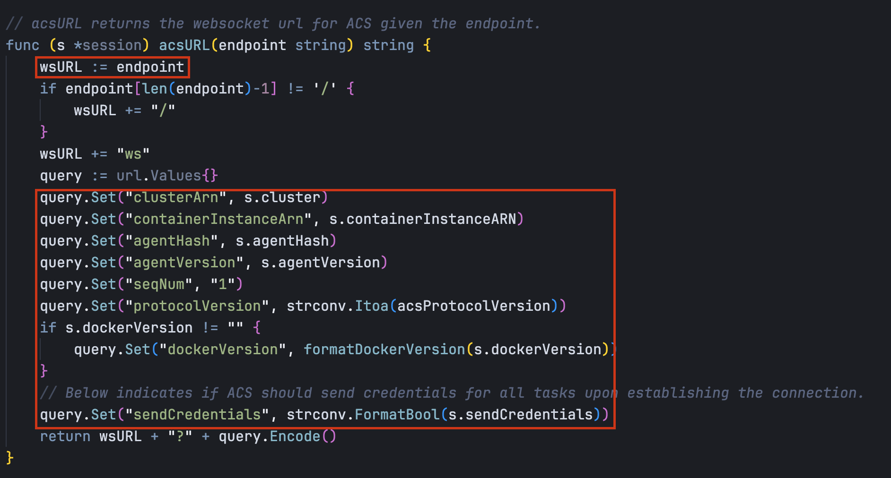

Agent가 WebSocket Session을 맺기 위한 URL 구성 로직

필요한 파라미터 중, seqNum, protocolVersion은 고정 값이며, dockerVersion은 docker version 명령을 통해 손쉽게 얻을 수 있습니다.

이 외에 <strong>Endpoint, clusterArn, containerInstanceArn, agentHash, agentVersion</strong>에 대한 정보를 획득하여 WebSocket URL을 구성하고, Agent로 Impersonate 해봅시다.

### [STEP1] DiscoverPollEndpoint API 통한 Endpoint 획득

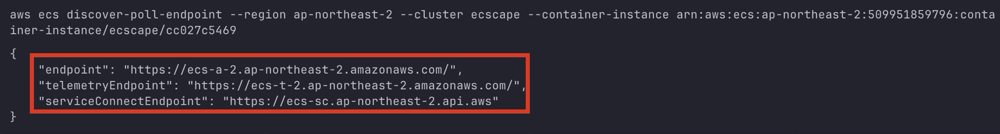

ECS 인스턴스에 대한 접근이 가능하다는 전제에서 시작합니다. 앞서 살펴봤던 것 처럼, InstanceRole은 기본적으로 Endpoint에 대한 polling 권한을 가지고 있습니다. 해당 API를 통해 Endpoint에 대한 정보를 획득할 수 있습니다.

하지만 DiscoverPollEndpoint API를 호출하기 위해서는 cluster의 이름과 container instnace에 대한 ARN이 필요합니다. 해당 정보는 Container Introspection API를 통해서 획득할 수 있습니다. (3번 과정 참고)

하지만 더 쉬운 방법은 앤드포인트 URL은 대체로 <em>ecs-a-1.{region}.amazonaws.com</em> 혹은 <em>ecs-a-2.{region}.amazonaws.com </em>와 같은 <strong>일정한 구조</strong>를 가지고 있습니다. 따라서 충분히 유추도 가능합니다.

### [STEP2] Container Introspection API를 통한 WebSocket URL 식별자 획득

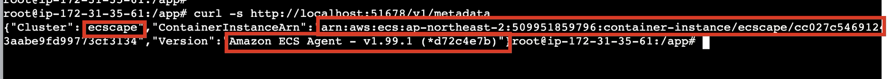

Agent가 실행 중인 컨테이너 인스턴스와 이 인스턴스에서 실행 중인 Task에 대한 세부 정보를 수집하기 위한 Container Introspection API를 통해, <strong>컨테이너가 실행 중인 Cluster 이름, ContainerInstaneArn, 그리고 Agent의 Version과 Hash까지 확인할 수</strong> 있습니다.

### [STEP3] Sigv4로 서명하여 ECS 서비스에 연결 수행

이로써 우리가 필요한 모든 정보를 획득하였습니다.

이렇게 구성한 <strong>WebSocket URL을 SigV4 SDK를 활용하여 서명</strong>하면 <strong>ACS 연결을 성공</strong>하게 되고, 다른 Task들의 자격증명을 수신받을 수 있는 상태가 됩니다.

Proxy를 통해 확인해보면, 아래 사진과 같이 다른 컨테이너에 접근 가능한 자격증명이 오가는 것을 확인할 수 있습니다.

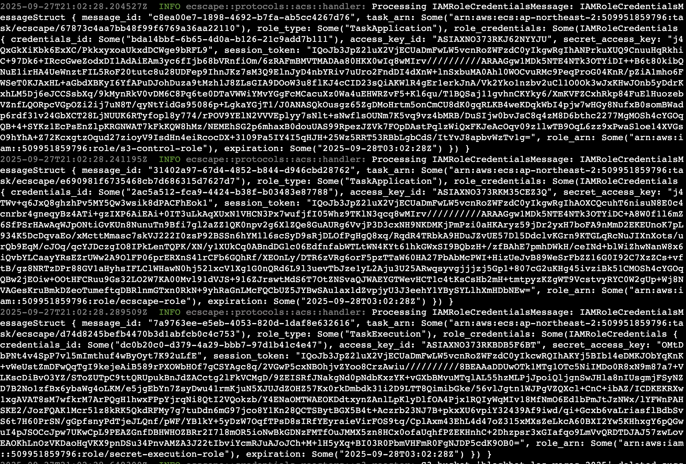

---

## 5. IMPACT & REMEDIATION

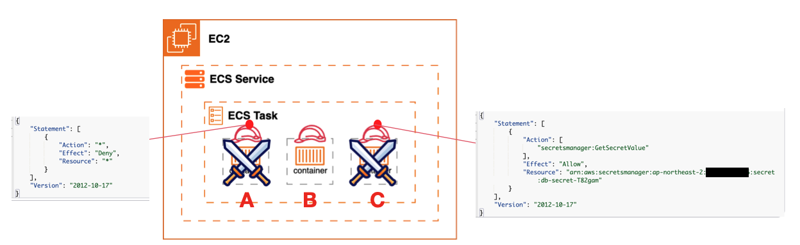

결국 최소권한 원칙을 적용했다고 해도, Task 내 어느 한 컨테이너가 설정 오류나 침해로 외부에서 접근 가능한 상태가 되면 심각한 연쇄 피해가 발생할 수 있습니다.

예를 들어 Task에 세 개의 컨테이너 A, B, C가 있고, A는 모든 action에 대해 Deny가 걸린 상태지만 C는 Secrets Manager의 Secret을 읽을 수 있는 권한을 가진다고 할때, 공격자가 A 컨테이너를 장악해 앞서 설명한 공격 흐름을 악용하여, 결국 C(또는 B) 컨테이너의 임시 자격증명까지 획득할 수 있습니다.

이렇게 획득한 자격증명으로 Secrets Manager에 저장된 비밀을 조회하면, <strong>단일 컨테이너 침해가 결국 Secret 유출과 계정 내 Lateral Movement로 이어지게 됩니다.</strong>

그렇다면 이러한 공격을 완화하고 예방하기 위해서는 어떤 조치가 필요할까요?

해당 취약점은 ECS와 ECS Agent간의 동작원리와도 깊은 관련이 있어, 실질적으로 API에 대한 아웃바운드 요청을 Deny하거나 메타데이터 조회가 불가능하도록 조치하는 것은 불가능합니다. 따라서 예방적 차원에서 아래와 같은 사항을 고려해볼 수 있습니다.

### 1) Fargate Launch Type 사용

ECS Launch Type 중 Fargate를 사용하면, Task가 EIP, CPU, Memory를 공유하지 않기 때문에 EC2 Launch Type의 사례처럼 하나의 컨테이너의 침해 여파가 다른 컨테이너에 전파되지 않게 됩니다. Fargate Launch Type에서는 AWS가 기본 인프라와 런타임 환경의 보안을 책임지는 공유책임모델 하에서 고객의 관리 부담이 크게 감소합니다.

특히 Fargate에서는 각 Task가 자체적인 VM 내에서 실행되어, Task간 Isolation이 강력하게 보장되어 다른 Task와의 커널, CPU, 메모리, 네트워크 인터페이스와 같은 기본 리소스들을 공유하지 않습니다. 따라서, 하나의 컨테이너 침해 여파가 다른 Task에 전파되는것을 효과적으로 방지합니다.

EC2 Launch Type에서는 컨테이너가 보안경계로 간주되지 않아 인스턴스 내 다른 컨테이너 및 Task와 리소스를 공유할 수 있습니다.

따라서 EC2 Launch Type에 대한 특별한 요구사항이 없다면, Fargate를 사용하는 것이 좋습니다.

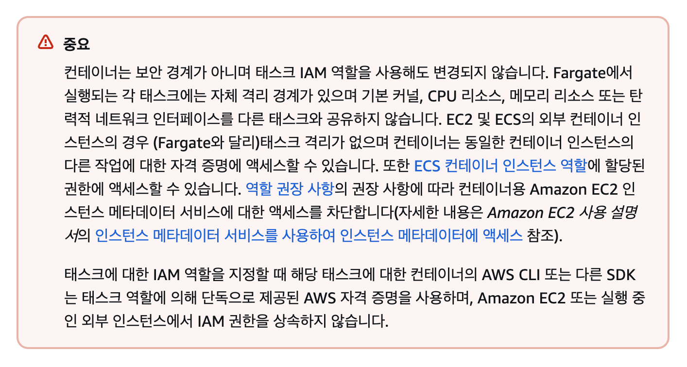

<a href="https://docs.aws.amazon.com/ko_kr/AmazonECS/latest/developerguide/task-iam-roles.html">https://docs.aws.amazon.com/ko_kr/AmazonECS/latest/developerguide/task-iam-roles.html</a>

### 2) 모니터링 수행

해당 공격을 모니터링하기 위해 두가지 지점에서 모니터링을 수행해볼 수 있습니다.

먼저, <strong>ecs:Poll, ecs:DiscoverPollEndpoint API에 대해 모니터링을 수행</strong>합니다. 해당 공격을 모니터링하기 위해 ecs:Poll, ecs:DiscoverPollEndpoint API에 대한 모니터링을 통해 정상적인 Agent 호출 패턴을 기준으로 삼아 이를 벗어나는 행위가 없는지 모니터링하는 것도 필요합니다.

두번째로는 <strong>네트워크 연결에 대한 모니터링을 수행</strong>합니다. ECS Agent는 일반적으로 특정 AWS Endpoint에만 연결합니다. 컨테이너 내부 프로세스 상에서 평소에는 연결하지 않는 외부 IP나 AWS 도메인에 웹소켓을 연결하거나, 비정상적인 아웃바운드 통신이 발생하는지 확인합니다.

이 외에도 공격 영향도를 최소화하기 위한 Task Role에 최소권한 부여 역시 필수적인 보안 대책입니다. ECS 리소스에 대한 정책을 설정할 시에, 리소스 수준의 권한을 사용하여 특정 작업을 허용할 수 있는 리소스를 지정합니다. 또한 Task Definition에 정의되는 권한 역시 꼭 필요한 AWS 서비스에 대해서만 API 호출을 허용하여 계정 내 모든 서비스와 리소스가 아닌 필요한 권한만 가질 수 있도록 설정하는 것이 필요합니다.

AWS는 해당 취약점에 대해서 EC2 Launch Type에 대해서 컨테이너가 같은 Host를 공유하면 동일한 신뢰 도메인으로 간주되는 설계상 동작으로 보고, CVE나 패치 없이 고객이 격리를 설계해야한다고 답변했습니다. 대신 공식 문서에 경고를 추가하여 Fargate를 사용하는 것으로 권고하였습니다.

AWS ECS는 강력하고 유연한 서비스지만, 그 유연함만큼 책임도 함께 요구됩니다.  EC2 Launch Type 환경에서의 보안 경계는 사용자가 직접 설계하고 관리해야 한다는 점을 잊지 말아야 합니다.

---

Beaver Dam 팀은 공격자의 시선에서 바라보는 Cloud 보안인, Offensive Cloud Security 분야를 연구하고 학습하고 있는 팀입니다. 매월 무료 세미나를 개최하며, 다양한 정보 아래 링크들에서 공유드리고 있으니 많은 관심을 부탁드립니다.

- LinkedIn : [https://www.linkedin.com/groups/14865006/](https://www.linkedin.com/groups/14865006/)
- Kakao Open Chat : [https://open.kakao.com/o/gVh8CYYh](https://open.kakao.com/o/gVh8CYYh)

---

<em>이 글은 BeaverDam 블로그에 처음 올린 글을 옮긴 것입니다. 원문: <a href="https://beaver-dam.tistory.com/12">https://beaver-dam.tistory.com/12</a></em>
